# Dispute Desk

**An AI dispute and chargeback desk for small PayPal sellers.** Marlow, a calm capybara clerk, reads every PayPal dispute, books the work on a team board before its deadline, builds the evidence, says whether to fight, offer or accept, drafts the response, and files it through the PayPal Disputes API once a person approves.

Built for the PayPal AI Hackathon. PayPal sandbox only: no real money moves.

- **Live demo:** https://hack-pp-disputedesk.vercel.app (PayPal sandbox; no login needed, and Replay plays recorded cases without using any up)
- **Demo video:** https://youtu.be/dLU-_NTq-0U (2:39). The same file is in [`demo/video.mp4`](demo/video.mp4), narration in [`demo/narration.txt`](demo/narration.txt)
- Devpost text: [`docs/devpost.md`](docs/devpost.md)
- What surprised us in the sandbox: [`docs/build-log.md`](docs/build-log.md)

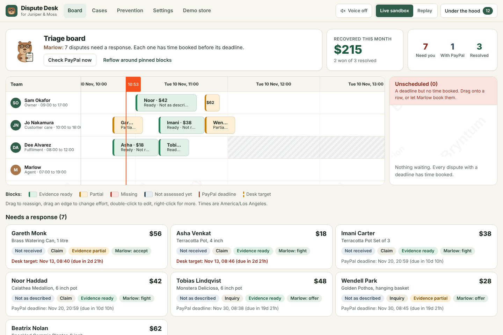

## The problem, and who this is for

A shop with one to ten people has nobody whose job is disputes. A dispute is deadline work that arrives without warning, needs evidence from three places (PayPal, the carrier, the shop's own inbox), and is easy to answer badly.

The deadlines are real. PayPal's developer documentation says a buyer can open a dispute within 180 days of a payment, that buyer and seller have 20 days to settle an inquiry between themselves, and that PayPal decides a claim within 10 days on the evidence from both parties [1]. In our sandbox runs a claim gave the seller 10 days to respond. PayPal's US fee page lists a standard dispute fee of 15.00 USD and says "We may charge a Dispute Fee when a buyer files a dispute claim or chargeback" [4].

So a lost claim can cost the sale, the goods and a fee, and the usual reasons for losing are ordinary: nobody owned it, the deadline slipped, or the wrong evidence went in.

## The aha

A dispute is two problems that are usually treated as one.

1. **It is scheduled work.** It has a deadline, an effort and an owner. So it belongs on a calendar board next to the team's working hours, not in an inbox. That is the hero screen, built on Bryntum Scheduler.
2. **It is a money decision.** Fight, offer or accept depends on what evidence exists and what the case is worth. That decision is made by fixed, tested rules in code. The model never decides money. It reads photos, explains the decision and writes the letter.

## A 60-second tour

**1. Disputes arrive and wait for a slot.** The desk polls `GET /v1/customer/disputes` (and listens for webhooks). A dispute with a deadline but no time booked sits in the Unscheduled panel. Drag it onto a person's row, or let Marlow book everything.

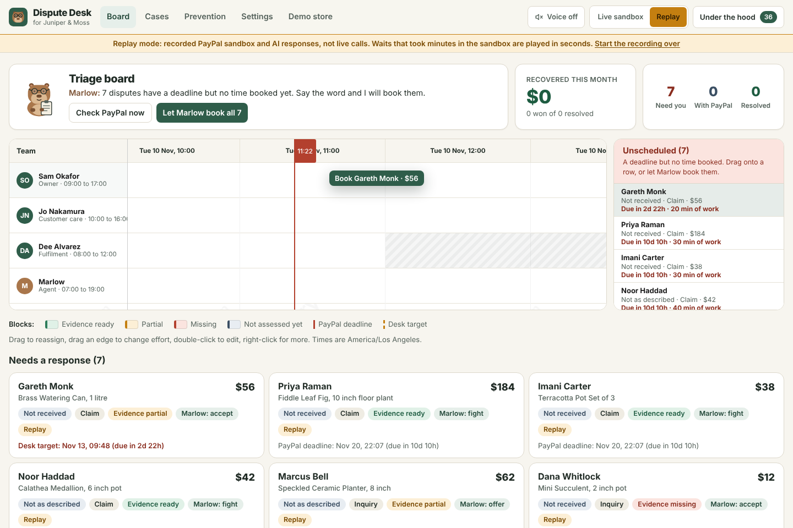

**2. Marlow books the work.** A deterministic scheduler puts each case into the earliest free slot before its deadline, inside each person's working hours, with a daily cap. Drag a block to reassign it or drag its edge to change the effort: the block is pinned and the rest reflows. A block whose time passes with no response goes back to Unscheduled and is booked again.

**3. The case file.** Order, capture and tracking come from PayPal. Carrier scans, signature, messages and photos come from the shop's records. A fixed table says what this dispute reason needs, each item adds or removes points, and the total is the win estimate. A vision model reads the delivery photo and its answer is one checklist item, tagged with the model's name.

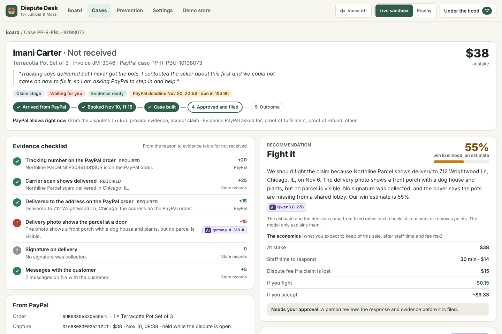

**4. Approve and file.** Marlow drafts the response and builds an evidence pack PDF. Only the actions PayPal lists in the dispute's `links` get a button, each labeled with its endpoint. One approval sends it.

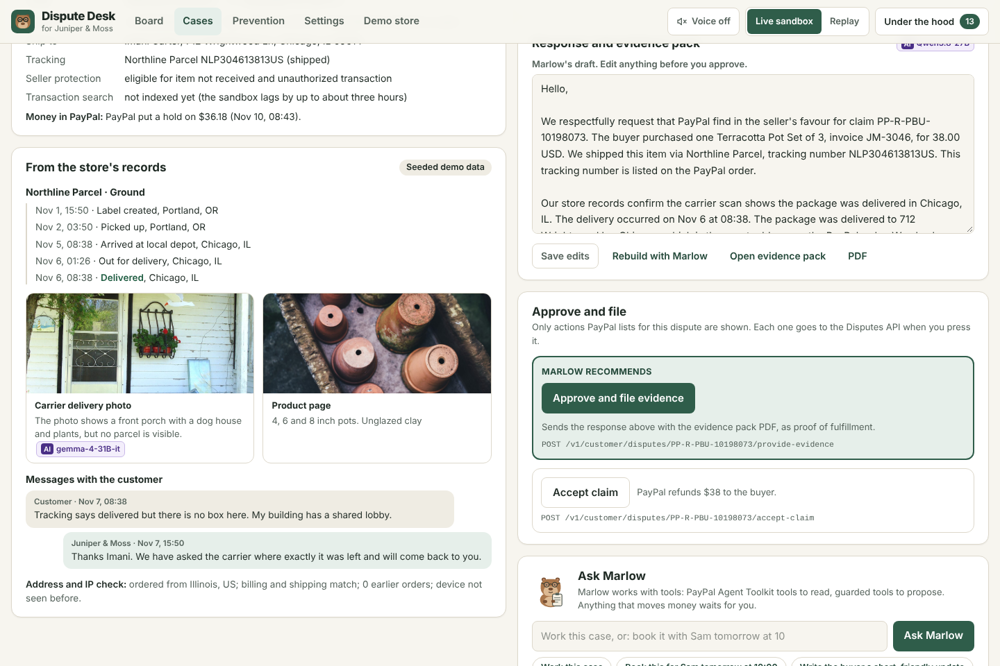

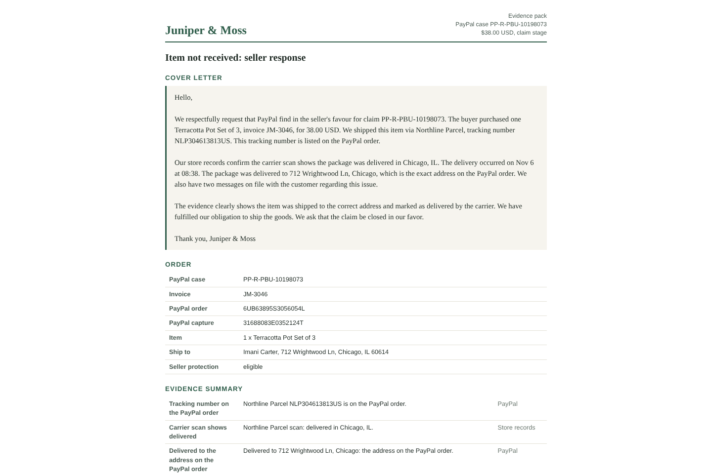

**5. The outcome.** When PayPal resolves the case the desk shows what happened to the money, from the dispute's `fund_movements`, and the "Recovered this month" counter goes up.

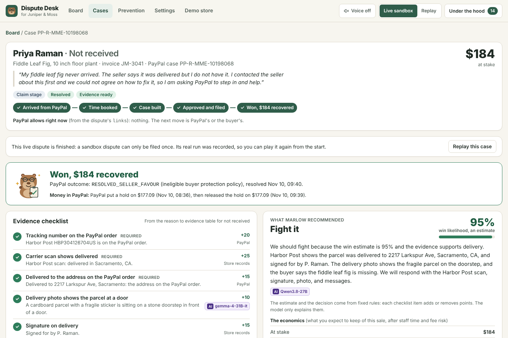

**6. Not every case should be fought.** A thin listing with no size chart gives a 45% estimate, so the rules say offer. The buyer accepted a $31 partial refund in PayPal and the case closed as an inquiry.

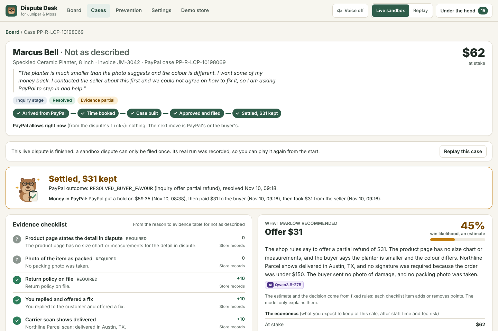

**7. Prevention.** Patterns are counted in code across cases (same product, same carrier, same shipping method). The model only writes the card.

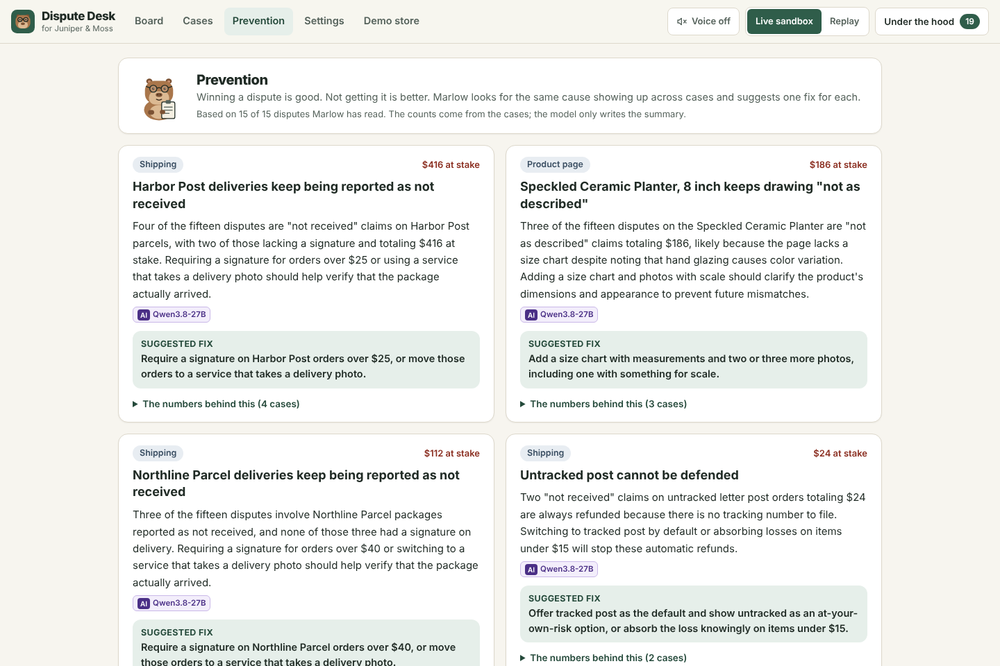

**8. The owner's rules.** Auto-accept small weak cases, always ask above an amount, what an hour of staff time costs. The guards read these before PayPal is called.

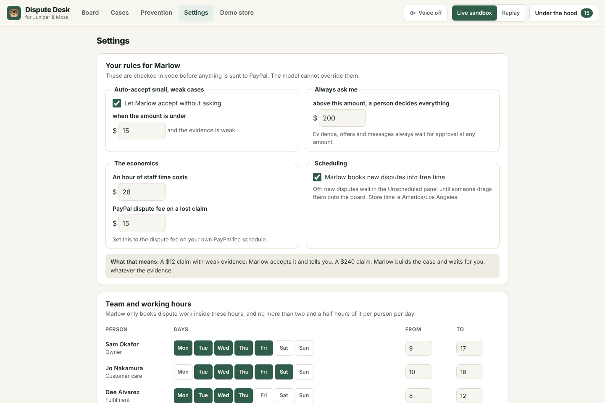

**9. Under the hood.** Every PayPal call this browser session caused, with method, path, status, PayPal-Debug-Id and the feature that asked.

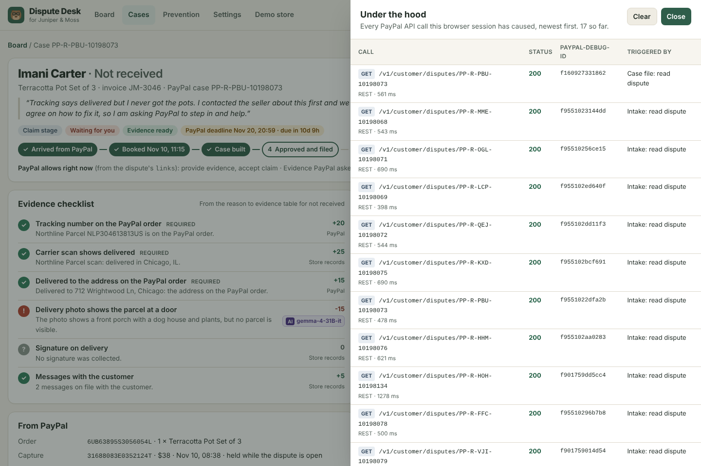

**10. Replay mode.** A sandbox dispute can be filed only once, so the header has a Replay switch. It plays recorded, real sandbox and model responses, per browser session, clearly labeled. Live sandbox is the default.

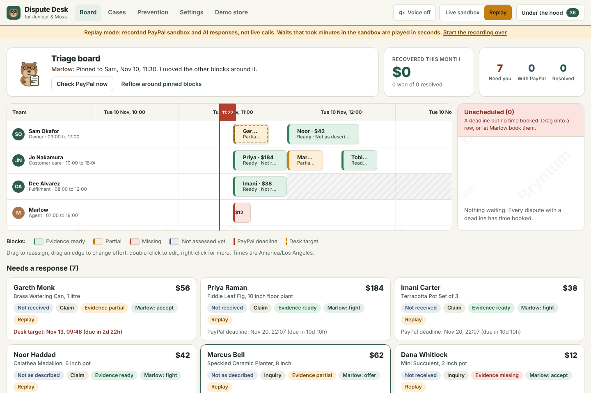

**11. The demo store.** A small checkout with the PayPal JS SDK v6, so anyone can make a sandbox payment and then dispute it.

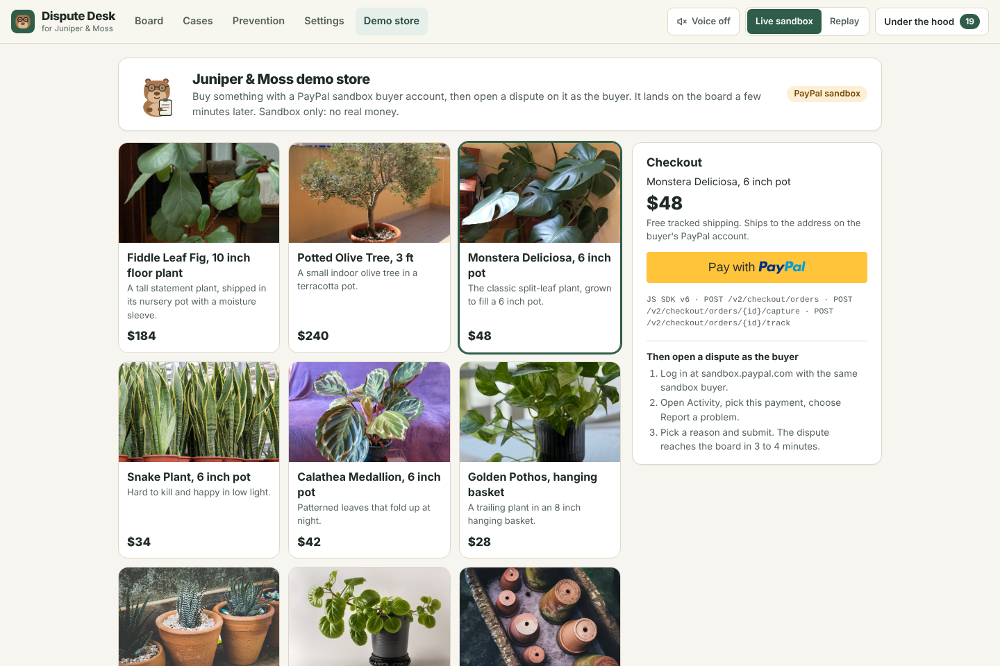

All twelve screenshots are real app states at 1440x960, taken by `pnpm screenshots`.

## How it works

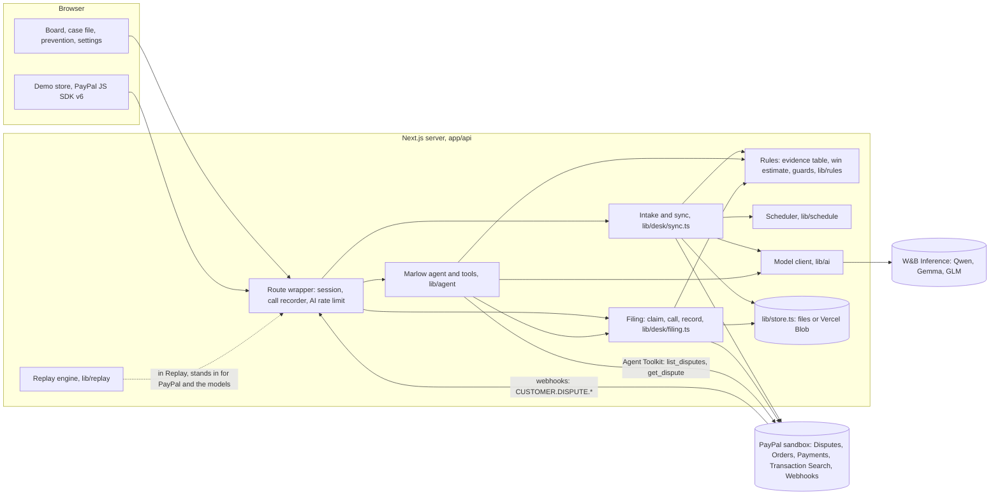

- **PayPal is the source of truth for money.** The store keeps PayPal ids and the desk's own working state (who is booked when, drafts, settings). Everything about money is read from PayPal again before it is shown or acted on.
- **Every dispute write takes one path** (`lib/desk/filing.ts`): check the action is in the dispute's `links`, check amounts and thresholds, claim the filing, call PayPal with a stored `PayPal-Request-Id`, record the result. If PayPal does not answer, the dispute is read again and the filing is marked unknown rather than guessed.
- **Webhooks only speed things up.** Every screen polls too, so nothing depends on delivery.

## PayPal: every API and feature, and where it is in the code

Host: `https://api-m.sandbox.paypal.com` only. `lib/env.ts` refuses to run unless `PAYPAL_ENVIRONMENT=sandbox`.

### Disputes API v1 (plain REST: the server SDK 2.5.0 does not cover Disputes)

All in `lib/paypal/disputes.ts`, sent through `lib/paypal/http.ts`.

| Endpoint | Function | Used for | Run live in the sandbox |
| --- | --- | --- | --- |
| `GET /v1/customer/disputes` | `listDisputes` | Intake polling: `syncDesk` in `lib/desk/sync.ts`, served by `app/api/board/route.ts` | yes |
| `GET /v1/customer/disputes/{id}` | `getDispute` | Case file, and a fresh read before and after every write (`lib/desk/filing.ts`) | yes |
| `POST .../{id}/provide-evidence` (multipart) | `provideEvidence` | Filing the response with the evidence pack PDF | yes |
| `POST .../{id}/provide-supporting-info` (multipart) | `provideSupportingInfo` | Evidence on a claim PayPal is already reviewing | yes |
| `POST .../{id}/make-offer` | `makeOffer` | Partial refund offers at the inquiry stage | yes, and accepted by the buyer |
| `POST .../{id}/send-message` | `sendMessage` | Messaging the buyer at the inquiry stage | yes |
| `POST .../{id}/accept-claim` | `acceptClaim` | Accepting, including Marlow's auto-accept under the owner's rule | yes |
| `POST .../{id}/escalate` | `escalateDispute` | Sending an inquiry to PayPal as a claim (case file and `pnpm seed`) | yes |
| `POST .../{id}/acknowledge-return-item` | `acknowledgeReturnItem` | Confirming a returned item | written, never offered by the sandbox |
| `POST .../{id}/appeal` (multipart) | `appealDispute` | Appealing a decision | written, never offered by the sandbox |
| `POST .../{id}/require-evidence` (sandbox only) | `requireEvidence` | "Ask the seller for evidence" in the sandbox tools | refused until the link appeared, then not needed |
| `POST .../{id}/adjudicate` (sandbox only) | `adjudicate` | "Settle in the seller's favor": playing PayPal's reviewer so a dispute can be tested end to end | yes |

The UI for these is `components/case/CasePage.tsx`; the route is `app/api/cases/[id]/file/route.ts`.

### Orders, Payments and Transaction Search (`@paypal/paypal-server-sdk` 2.5.0)

All in `lib/paypal/sdk.ts`.

| Endpoint | SDK call | Used for |
| --- | --- | --- |
| `POST /v2/checkout/orders` | `OrdersController.createOrder` | Demo store checkout (`app/api/store/orders/route.ts`) and `pnpm seed` |
| `POST /v2/checkout/orders/{id}/capture` | `OrdersController.captureOrder` | Capture after buyer approval (`app/api/store/orders/[id]/capture/route.ts`, seed) |
| `POST /v2/checkout/orders/{id}/track` | `OrdersController.createOrderTracking` | Tracking added at fulfilment: the first thing the evidence checklist looks for |
| `GET /v2/checkout/orders/{id}` | `OrdersController.getOrder` | Case file: items, ship-to address, trackers (`lib/desk/evidence.ts`) |
| `GET /v2/payments/captures/{id}` | `PaymentsController.getCapturedPayment` | Case file: capture status, seller protection, the related order id |
| `GET /v1/reporting/transactions` | `TransactionSearchController.searchTransactions` | Case file: transaction details. The sandbox index lags by hours, so empty means "not indexed yet" |

### Webhooks

| Endpoint or event | Where | Used for |
| --- | --- | --- |
| `POST /v1/notifications/webhooks`, `GET`, `DELETE` | `lib/paypal/webhooks.ts`, `scripts/paypal-webhook.ts` | `pnpm paypal:webhook <public-url>` registers the listener and prints `PAYPAL_WEBHOOK_ID` |
| `POST /v1/notifications/verify-webhook-signature` | `verifyWebhookSignature` in `lib/paypal/webhooks.ts` | Verifying each delivery against the raw body |
| `CUSTOMER.DISPUTE.CREATED`, `UPDATED`, `RESOLVED` | `app/api/paypal/webhook/route.ts` | Idempotent by event id; the handler re-reads the dispute from PayPal |

### PayPal Agent Toolkit (`@paypal/agent-toolkit` 1.11.0)

`lib/agent/tools.ts`. Marlow's agent uses the toolkit's `list_disputes` and `get_dispute` tools as they come. The toolkit's `accept_dispute_claim` moves money, so the agent is given a guarded tool of the same name instead: it re-reads the dispute, checks `accept_claim` is in `links`, checks the owner's thresholds, and either files through the one filing path or records a proposal for a person. `provide_evidence`, `make_offer` and `send_message` are written here and only ever produce proposals. The toolkit's own HTTP calls are logged in the Under the hood drawer (`lib/paypal/toolkit-log.ts`).

### PayPal JS SDK v6

`app/store/page.tsx`: loads `web-sdk/v6/core`, `createInstance`, `findEligibleMethods`, `createPayPalOneTimePaymentSession`, and a `<paypal-button>`. Verified with a real sandbox purchase (approval window, capture, tracking). Nothing in this build needed JS SDK v5.

### Across all calls

- **OAuth:** `POST /v1/oauth2/token`, client credentials, cached (`lib/paypal/http.ts`).
- **`PayPal-Request-Id`** on every REST POST and on order create and capture. The SDK's tracking call has no parameter for it, so that one POST goes without.
- **Only actions in `links`:** `allowedActions` in `lib/paypal/types.ts`, enforced in `lib/rules/guards.ts` and again in `fileAction`.
- **Retries** on 408, 429 and 5xx with backoff; one error mapping at the API boundary (`lib/api/route.ts`).
- **Seeding:** `pnpm seed` creates orders through the API, then approves them and opens disputes as the sandbox buyer through PayPal's own pages with Playwright (`scripts/seed.ts`, `scripts/lib/buyer.ts`). Opening a dispute through the API did not work for us; see the build log.

## The AI: which models, for what, and the guardrails

Models are served by W&B Inference through an OpenAI-compatible endpoint and the Vercel AI SDK (`lib/ai/client.ts`). Every AI output in the UI carries an "AI" tag naming the model that wrote it.

| Model | Used for | Where |
| --- | --- | --- |
| `Qwen/Qwen3.8-27B` | Explaining the recommendation, drafting the response, phrasing prevention cards, the scheduling note, and the tool-calling agent | `lib/ai/tasks.ts`, `lib/agent/run.ts` |
| `google/gemma-4-31B-it` (vision) | Reading delivery and damage photos: "does this show a parcel at a door?" | `readPhoto` in `lib/ai/tasks.ts` |
| `zai-org/GLM-5.3-Flash` | Fallback when the primary text model fails | `lib/ai/client.ts` |

What the model does not do:

- **It does not decide money.** Fight, offer or accept, the win estimate, the offer amount and what needs approval all come from `lib/rules` (the reason to evidence table, point scoring, thresholds, an economics check). These are covered by the tests.
- **It does not schedule.** `lib/schedule/scheduler.ts` is deterministic. The model only gets the scheduler's own sentences to summarize.
- **It does not count.** Prevention patterns are counted in `lib/desk/patterns.ts`.
- **It cannot file.** Every tool that could move money or speak for the shop checks the request in code and produces a proposal for a person. The single exception is the owner's own auto-accept rule (default: under $15 with weak evidence), which can be switched off in Settings.

Other guardrails: `maxRetries: 4` and a 60 second timeout on every call; a per-IP rate limit on the AI routes; a template letter built only from present evidence if both models fail; agent steps are logged to the case's trail; em and en dashes are stripped from model output. The writing tasks ask the models to answer without hidden reasoning, because on some prompts both models spent their whole token budget reasoning and returned nothing (measured with `scripts/dev/reasoning-probe.ts`; details in the build log).

The win estimate is always labeled as an estimate. It is a transparent point score, not a prediction learned from outcomes.

## Sponsor tools

### Bryntum Scheduler (the triage board)

`components/board/SchedulerBoard.tsx`, Bryntum Scheduler 7.3.8 with the React wrapper.

- People as resources with their working hours shaded (resource time ranges), a 07:00 to 19:00 working day, the shop's time zone.
- Deadlines as time ranges on the timeline; a current time line.
- An Unscheduled panel (a Bryntum Grid) with drag onto the timeline through a `DragHelper` subclass.
- Drag to reassign, resize to change effort, the block editor, tooltips, a context menu, and a drop validator that keeps Marlow's row for cases the auto-accept rule covers.
- Changes go through the event store so new bookings and reflows animate.
- Blocks are colored by evidence readiness and also carry a text label, so color is never the only cue.

This build uses the public **trial** package (`@bryntum/scheduler-trial`), which shows a watermark. It runs the same way on the hosted demo: the board loads and works there, with the trial watermark. Turbopack ran out of memory on the Scheduler bundle, so `pnpm dev` and `pnpm build` use webpack.

### APIMatic: PayPal server SDK and the PayPal Context Plugin

- `@paypal/paypal-server-sdk` (generated by APIMatic) makes every Orders, Payments and Transaction Search call.
- **How the Context Plugin was used.** Its nine `typescript-*` skills are in `.claude/skills/`, copied unchanged from the plugin marketplace repository (the `npx skills add` installer was not allowed to run in the build sandbox, so the brief's fallback was used). The build followed the plugin's method: a plan file with a contract sheet ([`paypal-plan.md`](paypal-plan.md)) before any integration code; every signature, request field and enum looked up in the installed package's type declarations rather than recalled; claim, then call, then record for writes; re-read on unknown outcomes; one error mapping at the API boundary.
- One mismatch to be honest about: the plugin documents APIMatic's newer generated package (`paypal`, `PaypalClient`), while this build's brief pins the published `@paypal/paypal-server-sdk` 2.5.0. We kept the published package and applied the plugin's workflow and rules to it.

## Run it locally

Needs Node 22, pnpm 10 and a PayPal sandbox account.

1. **Sandbox app.** In the PayPal Developer Dashboard, under Apps and Credentials (Sandbox), create a REST app on a sandbox business account. Enable Disputes and Transaction Search for the app. Copy the client id and secret.
2. **Sandbox buyer.** Create a sandbox personal account with a balance and set a password you know. `pnpm seed` logs in as this buyer to pay for orders and open disputes.
3. **Environment.**

   ```bash
   cp .env.example .env.local
   ```

   Fill in `PAYPAL_CLIENT_ID`, `PAYPAL_CLIENT_SECRET`, `NEXT_PUBLIC_PAYPAL_CLIENT_ID` (same as the client id), `PAYPAL_SANDBOX_BUYER_EMAIL`, `PAYPAL_SANDBOX_BUYER_PASSWORD`, `OPENAI_API_KEY` (a W&B Inference key; the base URL and model names are already in the example file) and `DEMO_ADMIN_TOKEN` (any long random string).
4. **Install, seed, run.**

   ```bash
   pnpm install
   ```

   ```bash
   pnpm exec playwright install chromium
   ```

   ```bash
   pnpm seed
   ```

   ```bash
   pnpm dev
   ```

   Open http://localhost:3000. `pnpm seed` takes 30 to 45 minutes because it waits on PayPal (an escalated inquiry becomes a claim about 11 minutes later). It is idempotent: run it again to finish, or `pnpm seed --batch B` to top up with fresh disputes. `pnpm seed --status` prints what exists. If the buyer pages change and the automation fails, [`docs/seed-disputes-by-hand.md`](docs/seed-disputes-by-hand.md) has the same steps by hand.

Without any keys the app still runs in **Replay** mode from `fixtures/replay/tape.json`.

Other commands:

| Command | What it does |
| --- | --- |
| `pnpm build`, `pnpm lint`, `pnpm test` | Production build, ESLint, Vitest (61 tests on the money rules, guards, scheduler, filing and store) |
| `pnpm paypal:webhook <public-url>` | Registers the dispute webhook and prints `PAYPAL_WEBHOOK_ID` |
| `pnpm replay:record <dispute-id>...` | Builds the Replay tape from recorded sandbox runs (`DISPUTEDESK_RECORD=1`) |
| `pnpm screenshots` | Retakes `docs/screenshots/` |
| `pnpm video narrate`, `record`, `compose`, `check` | Rebuilds the demo video (needs ffmpeg and an ElevenLabs key) |
| `POST /api/admin/reset` with header `x-admin-token` | Clears the desk's own state (not PayPal's) and re-reads PayPal |

State is kept in `.data/` locally and in Vercel Blob when `BLOB_READ_WRITE_TOKEN` is set. The desk only tracks disputes opened after the time in `data/desk-config.json` (`DESK_TRACK_FROM` overrides it), so earlier test disputes on the same sandbox account stay off the board.

## Sandbox logins for judges

- **The app needs no login.** The hosted demo opens straight onto the board, against a sandbox seller account that already has disputes waiting. Use Live sandbox to act on them, or Replay to play the recorded cases without using any up.
- **To settle a claim yourself:** file evidence on a claim, wait until PayPal lists the sandbox `adjudicate` link (about half an hour in our runs), then use "Settle in the seller's favor" in the case file's sandbox tools. Two seeded claims are left with evidence already filed for this purpose (look under "With PayPal or the buyer").
- **To be the buyer:** buy something on the Demo store page with any PayPal sandbox personal account, then log in at sandbox.paypal.com as that buyer, open Activity, pick the payment and choose "Report a problem". The dispute reaches the board 3 to 4 minutes later. We do not publish our own sandbox buyer's password in the repository.
- Sandbox only. No real money moves anywhere in this project.

## Accessibility

Built to WCAG 2.2 AA. Checked by hand at desktop and phone widths, from the keyboard, and with an automated axe-core scan (WCAG 2.0, 2.1 and 2.2 A and AA rules) of the board, the cases list, two case files, prevention, settings and the store at both widths (`scripts/dev/a11y.ts`).

- Text and controls meet AA contrast on the cream background; the status colors (ready, partial, missing) are always paired with a text label or an icon.
- Visible focus rings on every control, a skip link to the main content, and logical heading order.
- Every form control has a label; tables have captions and header cells; the stepper marks the current step.
- Async results (a filing, a new dispute, Marlow finishing) are announced through a polite live region as well as shown as toasts.
- `prefers-reduced-motion` turns off the board's animations.
- The board has a non-pointer path: "Let Marlow book" books everything, blocks are focusable (arrow keys move between them, Enter opens the block editor, which changes person and time without dragging), and the "Needs a response" cards under the board list the same cases as plain links.
- Each block's accessible name starts with the text visible on it, then gives the customer's full name, start time and length.
- Marlow's voice is off by default and has a visible toggle.

Known gaps:

- Dragging from the Unscheduled panel needs a pointer. The button and the editor cover the same job.
- The axe scan reports no violations on any page except one inside Bryntum Scheduler's own markup: its focusable event bars sit inside the grid's row group, which axe flags as `aria-required-children`. We left the vendor's roles alone because its keyboard navigation depends on them.

## Limitations, and what is next

- **The win estimate is rule-based.** Each checklist item is worth fixed points that we chose. It is not learned from past outcomes, and it is labeled as an estimate everywhere.
- **The fee model is an assumption.** The economics treat the dispute fee as charged only when a claim is lost. PayPal's fee page says it may charge the fee when a claim or chargeback is filed [4]. The exceptions are in PayPal's User Agreement, which we could not fetch from the build environment, so the amount and the rule are settings the owner sets from their own fee schedule.
- **The shop's records are seeded demo data.** Carrier scans, signatures, messages and photos come from `lib/shop/scenarios.ts` and are labeled "Seeded demo data". A real shop would connect its order system and carrier.
- **Webhooks were not exercised end to end.** The build environment has no public URL. The route verifies signatures with PayPal's verify endpoint and is idempotent, and the app polls regardless.
- **Not run live:** `appeal` and `acknowledge-return-item` (the sandbox never offered them), and "unauthorized transaction" disputes (the rules and tests cover them; we did not open them against our sandbox buyer).
- **Sandbox behaviour we work around:** "not received" on an order that already has tracking skips the inquiry stage; the sandbox settle link appears about half an hour after evidence is filed; Transaction Search lags by hours. The demo video cuts those waits and says so.
- **No sign-in.** One shop, one board, anyone with the URL can act on the sandbox disputes. `POST /api/admin/reset` is the only protected route.
- **Storage is simple.** JSON documents with a per-instance lock. Across server instances the last write wins, which is why filings carry a `PayPal-Request-Id` and are re-read from PayPal.
- **The model can be wrong.** Drafts and photo reads are suggestions a person reviews. Only the owner's auto-accept rule acts without a person.
- **Replay plays only what was recorded.** Any other action is refused with a message that says so.

Next: learn the point weights from resolved cases; carrier and order-system connectors; card chargebacks through the same board; per-person sign-in; evidence requests to the buyer as a first step before an offer.

## Credits

- Photos are from Wikimedia Commons under open licences, credited one by one in [`docs/CREDITS.md`](docs/CREDITS.md).
- Juniper & Moss, its customers, staff and carriers are fictional.
- Marlow the capybara was drawn for this project as SVG (`components/marlow/Marlow.tsx`). See [`TRADEMARKS.md`](TRADEMARKS.md).
- Narration and Marlow's voice lines: ElevenLabs `eleven_multilingual_v2`, premade voices, 5,325 characters in total ([`demo/elevenlabs-usage.json`](demo/elevenlabs-usage.json)). No music.
- Software: Next.js, React, Tailwind CSS, Vercel AI SDK, Zod, pdf-lib, Playwright, Vitest, `@vercel/blob`, Bryntum Scheduler (trial), `@paypal/paypal-server-sdk`, `@paypal/agent-toolkit`, the PayPal JS SDK v6, and the APIMatic PayPal Context Plugin skills (MIT, `.claude/skills/APIMATIC-LICENSE.txt`).
- PayPal, Bryntum, APIMatic, W&B and ElevenLabs are trademarks of their owners. This project is not endorsed by any of them.

## License

[AGPL-3.0](LICENSE). The product name "Dispute Desk" and the Marlow character are reserved: see [`TRADEMARKS.md`](TRADEMARKS.md).

## Sources

Each was read on Nov 10, 2026 while building.

1. PayPal Developer, Disputes overview: 180 days to open a dispute, 20 days to settle an inquiry, PayPal decides a claim within 10 days. https://developer.paypal.com/disputes/overview
2. PayPal Developer, Use Disputes API: which actions exist at each stage, and that PayPal requests specific evidence by reason. https://developer.paypal.com/platforms/disputes/handle-disputes/use-disputes-api
3. PayPal REST API specifications, `openapi/customer_disputes_v1.json`: evidence types, sources and request shapes. https://github.com/paypal/paypal-rest-api-specifications
4. PayPal US, Merchant fees, "Dispute Fees": Standard Dispute Fee 15.00 USD, High Volume Dispute Fee 30.00 USD, and the sentence quoted above. https://www.paypal.com/us/webapps/mpp/merchant-fees
5. PayPal Developer, Disputes API v1 reference. https://developer.paypal.com/docs/api/customer-disputes/v1/

Could not be fetched from the build environment, so nothing here relies on them: PayPal's Seller Protection page and the PayPal User Agreement.

Everything else stated about PayPal's behaviour was observed in our own sandbox runs and is written down, with times, in [`docs/build-log.md`](docs/build-log.md).
